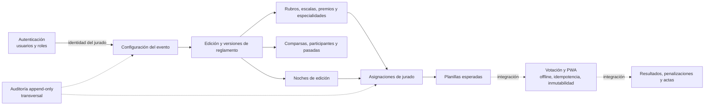
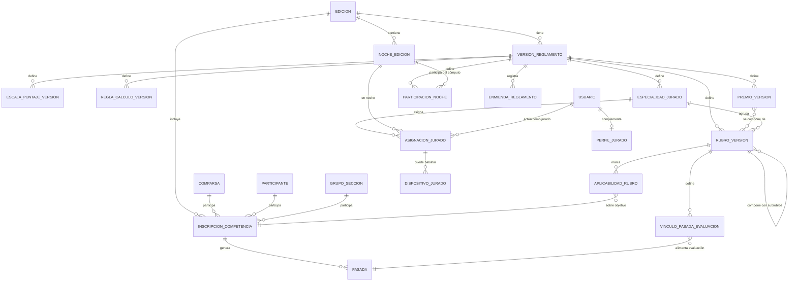
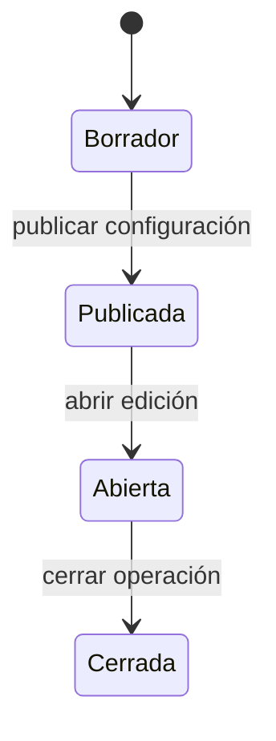
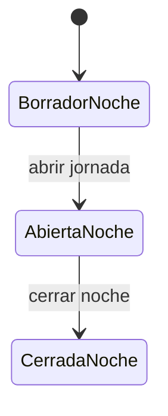

# Diseño de la base de datos de votación

**Estado:** Borrador para revisión; no define ni aplica migraciones. La Parte I
desarrolla las etapas 1–6 del [plan por etapas](event-database-plan.md); la
revisión funcional (etapa 7) está pendiente y la etapa 8 —diseño lógico y
migraciones— no se inicia.

**Propósito:** Modelar las reglas por edición, los votos digitales y los
resultados, conservando el secreto del voto y permitiendo operar sin conexión.
La Parte I detalla la configuración del evento; la Parte II cubre planillas,
sincronización y resultados.

**Referencias:** `AGENTS.md`,
[decisiones funcionales](decision-questions.md),
[creación de eventos y planillas](event-and-ballot-creation-design.md),
`authentication/README.md`, el Reglamento del Carnaval de Ciudad de Goya 2026
(PDF aportado con nombre de archivo que dice 2025) y el proyecto
`Carnavales2027`, usados como referencias que deben adaptarse, no copiarse sin
cambios. El reglamento de Goya es base provisional para la edición 2027, no una
aprobación integral de todas sus cláusulas.

**Índice:**

- [Decisiones confirmadas](#decisiones-confirmadas) y
  [límites del diseño](#límites-del-diseño)
- [Parte I — Configuración del evento](#parte-i--configuración-del-evento):
  inventario de decisiones, terminología, modelo conceptual, ciclo de vida,
  integridad y escenarios
- [Parte II — Votación, sincronización y resultados](#parte-ii--votación-sincronización-y-resultados)
- [Cierre — revisión, bloqueos y registro para migraciones](#cierre--revisión-bloqueos-y-registro-para-migraciones)

## Decisiones confirmadas

| Área | Decisión |
| --- | --- |
| Reglas | Cada edición tiene reglas versionadas y configurables por el administrador desde la aplicación. La configuración se limita a opciones de cálculo admitidas; una fórmula nueva requiere desarrollo. |
| Escala 2027 | Puntajes de 1 a 5; `0` significa únicamente `No se presentó`. La escala se adopta del reglamento base aportado. |
| Noches puntuables 2027 | La participación base comprende cuatro noches; para el cómputo de puntajes se cuentan las tres primeras noches oficiales. |
| Publicación | La edición debe tener reglas versionadas. Rubros y escalas quedan congelados al abrir la jornada; no se permiten cambios al reglamento después de esa apertura. |
| Alcance de evaluación | El modelo admite los 33 rubros de referencia, premios individuales y grupales, y el resultado general por comparsa. El reglamento base define un tratamiento especial para rubros nominativos y carros alegóricos; su adopción exacta para 2027 sigue pendiente (D24). |
| Unidad de voto | Una planilla completa por jurado, especialidad y noche, de acuerdo con las asignaciones activas. |
| Envío | La planilla no se puede confirmar si tiene puntuaciones requeridas incompletas. Una vez confirmada localmente, queda bloqueada para edición ordinaria; una vez recibida por el servidor, el voto es inmutable y no se reabre. |
| Secreto | Antes del cierre total, ningún rol —incluidos jurado, fiscal, escribano y administrador— recibe puntajes numéricos; solo estados. |
| Operación offline | La confirmación local bloquea la planilla en el dispositivo y la deja pendiente de recepción. No equivale a recepción oficial. |
| Cierre | El fiscal junto con el escribano realizan los cierres posteriores a la planilla del jurado. No se cierra una noche ni se publican resultados hasta que todas las planillas esperadas se hayan recibido por el servidor. La hora local de un dispositivo no demuestra por sí sola cuándo llegó un voto. |
| Penalizaciones 2027 | Se adoptan las penalidades del reglamento aportado: 0,50 puntos por minuto de retraso de ingreso/salida; 0,50 por minuto de exceso del show de batería, descontado de ese rubro; más de 30 minutos de retraso implica ceder el turno, desfilar al final y aplicar la sanción por 30 minutos; incumplir el mínimo de integrantes excluye de premios de comparsa, pero no de premios individuales. No afectan la evaluación artística del jurado. La evidencia, autorización y flujo de registro digital requieren especificación. |
| Resultados | Los resultados se calculan con la versión de reglas correspondiente. No se inventa un desempate: la resolución oficial debe quedar registrada antes de publicar el resultado. |

Esta tabla resume las reglas confirmadas. La sección I.1 las detalla con fuente y
estado e incluye también las decisiones provisionales y pendientes.

## Límites del diseño

Este documento propone el modelo conceptual y sus invariantes; no es DDL
ejecutable ni una autorización para crear migraciones. Los nombres siguientes
son conceptuales; los nombres físicos y tipos se decidirán al aprobar el diseño
detallado de migraciones. El proyecto usa PostgreSQL y nombres de tablas y
columnas en español.

La planilla imprimible y su carácter de requisito para 2027 siguen pendientes.
Si se aprueba, deberá derivarse del mismo voto digital. La decisión sobre cuándo
el jurado puede abrir o imprimir el PDF —en particular, cómo evitar que vea los
puntajes después de enviar— se deja para un feature posterior. Este documento no
afirma que una huella digital demuestre quién creó un archivo o que no se
modificó antes de sincronizarlo.

---

# Parte I — Configuración del evento

Esta parte desarrolla las etapas 1–6 del plan. Toda regla se marca como
**confirmada**, **provisional** o **pendiente**. Lo pendiente no se resuelve
aquí: se registra como bloqueo o se modela de manera neutral para no anticipar
una decisión.

## I.1 Inventario de decisiones y fuentes (etapa 1)

Fuentes consultadas: `AGENTS.md`, `decision-questions.md`,
`event-and-ballot-creation-design.md`, `authentication/README.md` y este mismo
documento.

| Regla o decisión | Fuente | Estado | Impacto en los datos del evento | Tratamiento en este diseño |
| --- | --- | --- | --- | --- |
| Escala 1–5; `0` solo para «No se presentó» | `AGENTS.md`, D22 | Confirmada | Define las escalas por rubro | La escala es dato de la versión de reglamento; no se fija en código |
| Voto confirmado inmutable | `AGENTS.md`, D12 | Confirmada | La configuración no puede reabrir ni alterar una planilla confirmada | Se modela como límite con votación; no se diseña edición de votos |
| Totales por suma; ítem padre suma hijos; sin descarte de nota | `AGENTS.md` | Confirmada | Afecta resultados, no la configuración del evento | Se modela como regla fija; no depende de opciones configurables |
| Rubros y escalas congelados al abrir la jornada; sin cambios al reglamento después | `AGENTS.md`, D5, D19 | Confirmada | Define transiciones y permisos de modificación | Se modela en el ciclo de vida (I.4) |
| Asignaciones nuevas solo mientras la jornada esté en `DRAFT`, aunque el evento esté `OPEN` | `AGENTS.md`, D5 | Confirmada | Define cuándo se pueden crear asignaciones | Regla de modificación por estado de la jornada |
| Asignaciones existentes revocables/reemplazables sin planilla confirmada | `AGENTS.md` | Confirmada | Define cuándo una asignación es modificable | Se modela como límite con votación |
| Borrado físico bloqueado si existe historial | `AGENTS.md` | Confirmada | Define reglas de eliminación | Catálogo de invariantes (I.5) |
| Idempotencia con identificador estable; nunca timestamps como única deduplicación | `AGENTS.md` | Confirmada | Afecta sincronización, no configuración | Se modela en la Parte II |
| Cierre bloqueado mientras haya planillas no recibidas por el servidor | `AGENTS.md`, D11 | Confirmada | Define cuándo se puede cerrar una noche | Regla de cierre (I.4 y Parte II) |
| Nadie ve puntajes numéricos antes del cierre total | `AGENTS.md`, D15 | Confirmada | Afecta API y resultados | Se modela en la Parte II |
| Auditoría append-only de operaciones sensibles | `AGENTS.md`, `authentication/README.md` | Confirmada como pauta; no implementada | Requiere registrar cambios administrativos | Se identifica como brecha a diseñar (I.5) |
| Nombres en español para tablas y columnas | `authentication/README.md` | Confirmada | Nomenclatura física | Se respeta; los nombres de aquí son conceptuales |
| Reglamento base «Goya 2026» con archivo que dice 2025 | D1 | Provisional | Define proveniencia de rubros y penalidades | Se cita como referencia provisional, no como aprobación |
| Tres primeras noches oficiales para el cómputo | D3, D13, `AGENTS.md` | Confirmada para 2027; calendario pendiente | Configuración de noches puntuables | Se modela como dato configurable; no se fija el número 3 |
| Penalidades del reglamento aportado | D14, `AGENTS.md` | Provisional en su flujo digital | Entidad de penalización | Se modela en la Parte II; flujo pendiente |
| Una planilla por jurado, especialidad y noche | D4 | Respondida; pendiente de armonizar | Define la unidad de planilla esperada | Se modela como derivada de la asignación |
| Cada pasada se evalúa por separado | D6, `event-and-ballot-creation-design.md` | Parcial | Define vínculos entre pasada y evaluación | Se modela el vínculo explícito; la consolidación queda bloqueada |
| Condición evaluable/no evaluable por rubro | D7 | Respondida | Define aplicabilidad de rubro a objetivo | Entidad explícita de aplicabilidad |
| Importación asistida con revisión | D8 | Parcial | Afecta carga de padrón | No se modela un formato de importación |
| Dos estados de planilla: local pendiente / recibida | D9 | Respondida; reintentos pendientes | Afecta sincronización | Se modela en la Parte II |
| Cierres: jurado, y fiscal con escribano | D10 | Parcial | Define etapas y actores | Se registran como integración; no se fijan condiciones no aprobadas |
| Fórmula de resultado general de comparsas | D24 | Pendiente | Afecta resultados, no configuración | No se implementa ni se modela como regla |
| Desempate, impugnaciones, votos tardíos | D16, D17, D18 | Pendientes | Afectan resultados y excepciones | No se inventan; se listan como bloqueos |
| Política de retención | D21 | Pendiente | Afecta borrado y conservación | Bloquea decisiones de eliminación de evidencia |
| PDF imprimible | D20 | Pendiente | Afecta documentos | Se trata como feature posterior |

**Resultado del gate 1:** no se incorporó ninguna regla inferida como aprobada.
Los puntos provisionales y pendientes figuran con su estado.

## I.2 Límite del modelo: terminología, glosario y contexto (etapa 2)

### I.2.1 Terminología propuesta — pendiente de confirmación

Los documentos usan «edición», «evento», «jornada competitiva» y «noche» con
matices distintos. Se propone esta correspondencia **para revisión**:

| Término del diseño | Uso en otras fuentes | Significado propuesto |
| --- | --- | --- |
| Edición | Edición; evento en `AGENTS.md` | Contenedor de una edición del carnaval (año, identidad y configuración) |
| Noche de edición | Noche; jornada competitiva | Cada noche en que se evalúa; tiene su propio estado operativo |
| Estado del evento | `OPEN` / `CLOSED` en `AGENTS.md` | Estado global de la edición |
| Estado de la jornada | `DRAFT` / abierta en `AGENTS.md` y D5 | Estado de una noche de edición |

Esta distinción es necesaria porque `AGENTS.md` permite eventos `OPEN` con
jornadas todavía en `DRAFT`. **Debe confirmarse antes de fijar nombres físicos.**

### I.2.2 Glosario

- **Edición:** contenedor de la configuración del carnaval de un año. Conserva su
  configuración publicada como versión.
- **Noche de edición:** aparición competitiva dentro de una edición. Tiene orden,
  fecha y estado operativo propio; su participación en el cómputo se define en
  la versión de reglamento, no como dato fijo de la noche.
- **Comparsa:** agrupación que participa en la edición. Su identidad puede
  reutilizarse entre ediciones.
- **Participante:** persona identificada una sola vez dentro de la edición,
  candidata a premios individuales. Su reutilización entre ediciones no está
  definida y se registra como bloqueo.
- **Grupo o sección:** agrupación evaluable distinta de una persona o comparsa;
  es un tipo de objetivo evaluable con inscripción propia. Cualquier otro tipo
  de elemento evaluable debe definirse antes de la etapa 8.
- **Pasada:** aparición de una persona, grupo u otro elemento en el desfile.
  Tiene posición en el orden de la edición y no es una copia del participante.
- **Objetivo evaluable:** comparsa, participante, grupo o pasada al que puede
  aplicarse un rubro.
- **Competencia o premio:** modalidad de evaluación, individual o grupal.
- **Rubro:** criterio de evaluación con especialidad responsable, objetivo y
  escala. Puede tener subrubros cuya suma compone el resultado del padre.
- **Especialidad de jurado:** agrupación de rubros que da origen a una planilla.
  Se propone definirla dentro de la versión de reglamento; su ámbito exacto está
  pendiente de confirmación.
- **Aplicabilidad:** dato explícito que indica si un objetivo recibe puntaje en
  un rubro. Un objetivo no evaluable se muestra como referencia, no admite
  puntaje y no cuenta como faltante.
- **Vínculo pasada-evaluación:** dato que indica qué pasada o participante
  alimenta un rubro y dónde se registra su puntaje. La aplicabilidad decide *si*
  se evalúa; el vínculo decide *qué fuente* produce el valor.
- **Asignación de jurado:** vínculo entre un usuario con rol de jurado, una
  especialidad y una noche de edición. Es la base de las planillas esperadas.
- **Planilla esperada:** resultado de una consulta derivada de la asignación,
  la especialidad, la noche y la versión de reglas. No es una planilla
  independiente ni una entidad con claves propias en este modelo. Su eventual
  materialización es una decisión pendiente por su efecto en los cierres.
- **Versión de reglamento:** configuración inmutable de rubros, escalas y reglas
  de una edición. Las planillas y los votos referencian una versión concreta.

### I.2.3 Diagrama de contexto

### I.2.4 Límites de la Parte I

**Dentro del alcance:** edición, versiones de configuración, noches, comparsas,
participantes, pasadas, rubros, escalas, premios, especialidades, aplicabilidad
y asignaciones, y el vínculo con planillas esperadas.

**Fuera del alcance, documentado en la Parte II:** captura y envío de
puntuaciones, sincronización offline, cierres, penalizaciones, resultados,
desempates, actas y PDF imprimible.

**Resultado del gate 2:** se propuso una terminología y un límite. Queda pendiente
la confirmación de nombres y responsabilidades antes de enumerar la estructura
física.

## I.3 Modelo conceptual del evento (etapa 3)

### I.3.1 Diagrama entidad-relación

La **planilla esperada** no figura como entidad: se obtiene por consulta a partir
de la asignación, la noche, la especialidad y la versión. Si se decide
materializarla, el modelo y las reglas de cierre deben revisarse antes de la
etapa 8.

### I.3.2 Catálogo de entidades

| Entidad | Propósito | Identidad y relaciones principales |
| --- | --- | --- |
| **Edición** | Contenedor de la configuración del evento | Identidad propia; contiene noches, inscripciones y versiones |
| **Versión de reglamento** | Configuración de una edición; lo publicado es inmutable | Pertenece a una edición; número de versión, estado, fuente, autoría y fechas de aprobación/publicación/congelamiento |
| **Enmienda de reglamento** | Registra cambios posteriores a la versión publicada | Pertenece a una versión de origen; conserva contenido, motivo, responsable y fecha; no reescribe la versión ni los votos |
| **Noche de edición** | Cada noche competitiva de la edición | Pertenece a una edición; orden, fecha y estado. Su participación en el cómputo se define por versión |
| **Participación de noche por versión** | Indica si una noche participa del cómputo según una versión | Asocia noche y versión; no fija una cantidad de noches |
| **Comparsa** | Identidad estable de una comparsa | Se inscribe en una edición; su identidad puede reutilizarse entre ediciones |
| **Participante** | Identidad de una persona evaluable | Una sola identidad por edición; no se duplica por tener varias pasadas. Reutilización entre ediciones pendiente |
| **Grupo o sección** | Agrupación evaluable distinta de persona o comparsa | Se inscribe en una edición; tipo de objetivo evaluable |
| **Inscripción de competencia** | Vincula edición con comparsa, participante, grupo u objetivo evaluable | Evita duplicar el modelo de planillas; referente de aplicabilidad |
| **Pasada** | Aparición ordenada de un objetivo en el desfile | Pertenece a una inscripción; posición única en la edición; una persona puede tener varias |
| **Rubro de versión** | Criterio evaluable dentro de una versión | Pertenece a una versión; objetivo, especialidad y jerarquía de subrubros |
| **Escala de puntaje de versión** | Valores o límites permitidos por rubro | Pertenece a una versión; para 2027, 1–5 con `0` separado para «no se presentó»; representación a decidir |
| **Regla de cálculo de versión** | Algoritmo admitido y parámetros validados | Pertenece a una versión; no ejecuta fórmulas arbitrarias ni contradice la suma obligatoria de subrubros |
| **Premio de versión** | Premio individual o grupal y su modalidad | Pertenece a una versión; se compone de rubros; la composición concreta se define al cargar el reglamento |
| **Especialidad de jurado** | Agrupa los rubros de una planilla | Definida en una versión —propuesta a confirmar—; relaciona rubros con asignaciones |
| **Aplicabilidad de rubro** | Marca si un objetivo es evaluable en un rubro | Explícita por rubro e inscripción; decide *si* se evalúa, no la fuente del valor |
| **Vínculo pasada-evaluación** | Indica qué pasada o participante alimenta un rubro y dónde se registra | Explícito y revisable; decide la fuente del valor; la consolidación de varias pasadas sigue pendiente (D6) |
| **Perfil de jurado** | Datos propios del jurado | Complementa un usuario de autenticación; no reemplaza su identidad |
| **Asignación de jurado** | Jurado, especialidad y noche | Se crea mientras la jornada esté en `DRAFT`; base de planillas esperadas |
| **Dispositivo de jurado** | Opcional; dispositivo habilitado para trabajo offline | Enrolamiento y recuperación requieren diseño posterior |

La planilla esperada se deriva por consulta de la asignación, la noche, la
especialidad y la versión; no se mantiene como entidad con claves propias.

### I.3.3 Decisiones modeladas de forma neutral

- El número de noches no se fija: la participación en el cómputo se guarda en la
  relación entre noche y versión. La regla de «tres primeras noches» se registra
  como dato de configuración para 2027, no como constante del modelo.
- La fórmula de resultado general (D24) no se modela: las reglas de cálculo
  admitidas se representan como selección de algoritmo, sin anticipar cuál se
  adopta. Esta selección no puede contradecir la suma obligatoria de subrubros.
- La consolidación de varias pasadas (D6) no se decide: se guarda el vínculo
  explícito entre pasada y evaluación, sin regla automática de suma, promedio o
  selección.
- La planilla esperada se deriva por consulta. Materializarla como entidad
  persistida tendría efecto en cómo se comprueban los cierres; por eso esa
  decisión queda pendiente y no se adelanta en el modelo.
- Los premios se componen de rubros, pero no se fija qué premios existen ni qué
  rubros los componen: eso se define al cargar el reglamento de cada edición.
- La especialidad se define dentro de la versión como propuesta de modelado; su
  ámbito debe confirmarse en la revisión funcional.
- Los usuarios de autenticación se referencian, pero no se redefine su modelo;
  el efecto de eliminar cuentas sobre asignaciones históricas se revisa en I.5.

**Resultado del gate 3:** los escenarios de alta, edición, publicación y consulta
pueden representarse con estas entidades. Queda verificarlo con los escenarios de
I.6.

## I.4 Ciclo de vida y versionado de la configuración (etapa 4)

### I.4.1 Estados propuestos — pendientes de confirmación

| Objeto | Estados | Observación |
| --- | --- | --- |
| Edición | Borrador → Publicada → Abierta → Cerrada | «Publicar» y «abrir» son acciones distintas: publicar fija la configuración; abrir inicia la operación |
| Noche de edición | Borrador → Abierta → Cerrada | Corresponde a la jornada competitiva de `AGENTS.md` |
| Versión de reglamento | Borrador → Publicada → En uso → Histórica | «Congelada» no es un estado separado: el congelamiento es una condición que se produce al abrir la jornada, según las reglas confirmadas |

Los nombres exactos de los estados deben confirmarse; las transiciones
reflejan las reglas confirmadas. Una edición abierta puede tener noches todavía
en borrador, según `AGENTS.md`; el estado de la edición no implica que todas sus
noches estén abiertas.

### I.4.2 Reglas de modificación por estado

| Situación | Regla | Fuente |
| --- | --- | --- |
| Edición en borrador | Se pueden crear y modificar noches, comparsas, participantes, pasadas, rubros, escalas, premios y asignaciones | Confirmada por diseño; detalle pendiente (D5) |
| Publicar edición | Se crea la versión de reglamento que origina las planillas; la configuración publicada no se altera silenciosamente | `event-and-ballot-creation-design.md` |
| Crear asignación | Solo mientras la jornada esté en `DRAFT`, aunque la edición esté abierta | `AGENTS.md`, D5 — confirmada |
| Abrir jornada | Congela rubros y escalas; no se permiten cambios al reglamento de esa jornada | `AGENTS.md`, D19 — confirmada |
| Revocar o reemplazar asignación | Permitido mientras no tenga planilla confirmada | `AGENTS.md` — confirmada |
| Planilla confirmada | Bloquea cambios que alteren su evidencia; el voto es inmutable | `AGENTS.md` — confirmada |
| Cerrar noche | Bloqueado mientras haya planillas esperadas no recibidas por el servidor | `AGENTS.md`, D11 — confirmada |
| Enmienda al reglamento | Se registra como nueva versión o enmienda; no reescribe la versión congelada ni votos existentes | D19; procedimiento pendiente |

Una nueva versión puede copiar la configuración anterior como borrador editable
antes de abrir la jornada. Después de abrirla no se permiten cambios al
reglamento de esa jornada. Publicar o congelar una versión no cambia las filas
de votos ni los resultados ya calculados.

### I.4.3 Diagrama de estados

Estados de la edición:

Estados de una noche de edición:

**Resultado del gate 4:** el ciclo respeta las reglas confirmadas; las
excepciones no definidas quedan marcadas como bloqueadas.

## I.5 Integridad, permisos y trazabilidad (etapa 5)

### I.5.1 Invariantes propuestos

| Invariante | Justificación |
| --- | --- |
| Una planilla por jurado, especialidad y noche | Unidad de voto confirmada (D4); la planilla recibida se materializa en la Parte II, la esperada se deriva aquí |
| La posición de una pasada es única dentro de una edición | Orden compartido del desfile |
| Un objetivo no evaluable en un rubro no admite puntaje ni cuenta como faltante | D7 y diseño de creación de planillas |
| Un rubro evaluable debe tener definida su fuente de valor | La aplicabilidad decide si se evalúa; el vínculo pasada-evaluación indica qué fuente produce el puntaje. Sin él, la planilla sería ambigua |
| Un premio debe componerse de al menos un rubro | Evita premios sin criterio de evaluación |
| La participación de una noche en el cómputo se define por versión | Evita mezclar configuraciones de distintas ediciones |
| Noche, comparsa, participante, grupo, pasada y rubro deben pertenecer a la edición correspondiente | Evita referencias cruzadas entre ediciones |
| Un rubro con subrubros no recibe nota manual; su resultado es la suma de los hijos | Regla confirmada en `AGENTS.md` |
| No se admite una versión de reglamento duplicada para una edición y número | Conserva versiones identificables |
| Borrado físico bloqueado si existe historial de votos, cierres, penalizaciones, actas, sesiones o auditoría | `AGENTS.md` |
| La identidad de un participante se conserva aunque tenga varias pasadas | Diseño de creación de planillas |

### I.5.2 Eliminación y usuarios

- La eliminación de usuarios ya existe en autenticación y borra credenciales,
  sesiones y asignaciones en cascada. Antes de implementar claves foráneas desde
  asignaciones históricas debe revisarse ese comportamiento para no perder
  trazabilidad de votos ya emitidos.
- Las relaciones con usuarios no deben borrar en cascada votos, asignaciones ni
  resultados históricos.
- Ninguna entidad del evento debe borrarse en cascada sobre planillas, votos o
  resultados.

### I.5.3 Permisos y trazabilidad

- La configuración del evento es administrativa. El alta, modificación,
  publicación, apertura, cierre y guardado de orden son operaciones sensibles y
  requieren confirmación explícita en la interfaz (`AGENTS.md`).
- La API debe autorizar contra la sesión autenticada y las asignaciones reales,
  no contra campos enviados por el cliente.
- Las operaciones sensibles requieren evidencia append-only. La auditoría
  administrativa no está implementada en autenticación; es una brecha a diseñar
  antes de producción (`authentication/README.md`).

### I.5.4 Catálogo de operaciones sensibles

| Operación | Actor previsto | Evidencia requerida |
| --- | --- | --- |
| Crear/modificar/borrar comparsa, participante o pasada | Administrador | Registro append-only con actor, fecha del servidor y entidad afectada |
| Guardar orden de pasadas | Administrador | Registro append-only |
| Crear/revocar/reemplazar asignación | Administrador | Registro append-only; bloqueada con planilla confirmada |
| Publicar edición / abrir o cerrar jornada | Administrador | Registro append-only; cierre bloqueado si faltan planillas |
| Modificar reglamento | Administrador | Nueva versión o enmienda; nunca reescritura silenciosa |

**Resultado del gate 5:** la integridad no queda delegada al frontend; se
identificaron las reglas que la API y la base deben sostener. El diseño físico
de restricciones se pospone a la etapa 8.

## I.6 Escenarios de validación del modelo (etapa 6)

| # | Escenario | Resultado esperado |
| --- | --- | --- |
| 1 | Edición con varias noches; solo algunas participan del cómputo | El modelo permite marcar la participación por noche sin fijar una cantidad |
| 2 | Participante con varias pasadas en una misma edición | Una sola identidad de participante y varias pasadas ordenadas; sin consolidación automática |
| 3 | Objeto marcado como no evaluable en un rubro | Aparece como referencia, sin control de puntaje y sin contar como faltante |
| 4 | Rubro con subrubros | El padre no admite nota manual; se deriva de los hijos por suma |
| 5 | Especialidad con rubros evaluables y sin jurado asignado | Bloqueante para publicar o abrir, según validaciones del diseño de creación |
| 6 | Alta de asignación en jornada abierta | Bloqueada; solo se permite en `DRAFT` |
| 7 | Cambio de escala después de abrir la jornada | Bloqueado; la escala queda congelada |
| 8 | Intento de borrar una comparsa con planillas o votos asociados | Bloqueado para preservar evidencia |
| 9 | Preparación de planillas esperadas | Se derivan de asignación, noche, especialidad y versión; no se crean planillas independientes |
| 10 | Cierre de noche con planilla local confirmada pero no recibida | Bloqueado; el estado local no equivale a recepción oficial |
| 11 | Rubro evaluable sin vínculo pasada-evaluación | Se marca como inconsistencia bloqueante; no se genera una planilla ambigua |
| 12 | Premio sin rubros que lo compongan | Se marca como inconsistencia bloqueante antes de publicar |
| 13 | Grupo o sección como objetivo evaluable | Se inscribe en la edición y recibe aplicabilidad de rubro como cualquier otro objetivo |
| 14 | Participación de una noche en el cómputo | Se define por versión; cambiar de versión no altera la noche ni votos existentes |

Estos escenarios son de diseño. Sus pruebas automatizadas se definirán con el
diseño lógico y las migraciones, en la etapa 8.

**Resultado del gate 6:** los invariantes principales tienen un escenario que los
comprueba; el modelo no obliga a decidir reglas pendientes de cómputo.

---

# Parte II — Votación, sincronización y resultados

## II.1 Planillas, puntajes y sincronización

| Entidad | Responsabilidad y restricciones conceptuales |
| --- | --- |
| `planilla` | Una planilla por jurado, especialidad, edición y noche. Guarda la asignación y versión de reglamento aplicables, estado local/de recepción y fechas del servidor. Una restricción única impide una segunda planilla para esa misma combinación. |
| `puntaje_planilla` | Un valor por planilla, rubro y objetivo evaluado. La combinación debe ser única; los valores deben cumplir la escala de la versión de reglas asociada. |
| `operacion_sincronizacion` | Registra el identificador idempotente del envío, el hash del contenido recibido, la fecha del servidor y el acuse devuelto al dispositivo. Repetir el mismo envío no crea otra planilla ni altera la existente. |
| `auditoria_votacion` | Registra eventos relevantes —confirmación local declarada, recepción del servidor, rechazo por conflicto y cierre— con actor, fecha del servidor y referencia a la entidad afectada. No almacena una segunda copia editable de los puntajes. |

En el dispositivo, la planilla confirmada localmente queda bloqueada y en estado
pendiente de recepción. La interfaz no la presenta como recibida oficialmente.
Al sincronizar, el servidor valida edición, asignación, especialidad, noche,
versión, completitud, integridad e identificador idempotente y registra la
planilla y sus puntajes en una transacción. Un conflicto se rechaza y se audita;
nunca sobrescribe otro voto. La política de reintentos automáticos queda
pendiente de diseño.

La respuesta de sincronización incluye un acuse persistible por el dispositivo.
El cierre comprueba que todas las planillas esperadas estén recibidas y que no
queden asignaciones pendientes. Si falta un dispositivo o no puede sincronizarse,
el cierre permanece bloqueado; no hay procedimiento excepcional aprobado.

## II.2 Archivos imprimibles

El archivo imprimible debe corresponder al mismo contenido confirmado de la
planilla, no a una transcripción separada. La base guardaría metadatos del
archivo —identificador, tipo, referencia de almacenamiento, huella
criptográfica y vínculo al voto—; el binario se conservaría en almacenamiento
de archivos, no como contenido principal de una fila relacional.

La generación offline, el control de acceso al PDF, la impresión y su
sincronización se implementarán como un feature posterior. La huella detecta
cambios en el archivo comparado con la huella registrada, pero no prueba por sí
sola la autenticidad del origen ni el estado del archivo antes de su primera
sincronización.

## II.3 Resultados y publicación

Los puntajes que participan del cómputo de 2027 corresponden a las tres
primeras noches oficiales. La regla de suma general por comparsa todavía debe
precisarse: el reglamento aportado distingue rubros fijos, rubros nominativos y
carros alegóricos. La adopción de su fórmula detallada está pendiente de la
decisión D24.

| Entidad | Responsabilidad |
| --- | --- |
| `resultado_calculado` | Snapshot inmutable de resultados generado desde los votos recibidos, la versión de reglamento y el algoritmo admitido. Conserva identificadores de entrada y fecha de cálculo. |
| `resultado_rubro` | Resultado por rubro y objetivo evaluado, vinculado al snapshot. |
| `penalidad` | Registra penalidades separadas del puntaje artístico, con motivo, importe o efecto y evidencia pertinente. |
| `resolucion_empate` | Registra la resolución oficial, responsable, motivo y fecha; no crea un criterio automático no previsto por el reglamento. |
| `publicacion_resultado` | Registra qué snapshot fue publicado, por quién y cuándo. Solo puede apuntar a un cálculo completo y a empates resueltos oficialmente. |

Un recálculo crea otro snapshot; no modifica uno publicado. La publicación
requiere que la votación esté cerrada, todas las planillas esperadas estén
sincronizadas y las resoluciones de empate estén registradas.

## II.4 Acceso y protección del secreto

- La interfaz muestra al jurado solo el estado de sus rubros y de su planilla
  enviada; la API no debe devolverle los puntajes después de la confirmación.
- Antes del cierre, la API no devuelve puntajes al administrador. El estado de
  recepción puede mostrarse por separado.
- Los servicios de cálculo acceden a los puntajes solo en el flujo de cierre y
  resultados autorizado. Ocultar números en la interfaz no reemplaza la
  autorización de la API.
- Los votos confirmados no se borran ni se editan mediante las rutas ordinarias.
  Correcciones por fallas excepcionales requieren una política separada; no se
  asume reapertura.
- El almacenamiento offline debe proteger datos locales frente al acceso casual
  o a la pérdida del dispositivo. El alcance de cifrado, gestión de claves y
  recuperación se especificará en el diseño del cliente.

## II.5 Diferencias con `Carnavales2027`

Se toman como referencias sus patrones de planillas vinculadas a jurado/noche,
puntajes separados, restricciones relacionales, auditoría y snapshots de
resultados.

No se copia sin adaptar:

- La escala de puntuación de esa aplicación; las escalas deben provenir de la
  versión de reglas de cada edición.
- La visualización de valores numéricos al jurado después del envío.
- La falta de un mecanismo confirmado de versionado del reglamento por edición.
- La falta de evidencia confirmada de generación y archivo de PDF imprimible.

La referencia es solo de lectura: no se modifican sus tablas ni su flujo.

---

# Cierre — revisión, bloqueos y registro para migraciones

## Estado de revisión (etapa 7)

Este diseño está listo para revisión funcional, pero **no está aprobado**. Para
avanzar a la etapa 8 se requiere:

1. Confirmar la terminología de edición, evento, jornada y noche.
2. Confirmar o ajustar el alcance y los nombres de las entidades.
3. Confirmar el alcance del congelamiento: versión por edición frente a
   congelamiento por jornada.
4. Resolver o aislar formalmente los bloqueos que afectan el esquema.
5. Registrar la aprobación sin borrar el historial de decisiones.

## Bloqueos y decisiones que este diseño no resuelve

- Terminología de edición/evento/jornada/noche (I.2).
- Alcance del congelamiento: la versión se define por edición, pero la regla
  confirmada congela rubros y escalas al abrir una jornada. No está definido qué
  ocurre cuando una edición tiene varias noches que se abren en momentos
  distintos (I.4).
- Representación de `0`: si es un valor de escala con marca o un campo separado
  (etapa 8; no se decide aquí).
- Reutilización de la identidad de participantes entre ediciones (I.3).
- Tipos adicionales de objetivo evaluable fuera de comparsa, participante y
  grupo o sección (I.3).
- Ámbito de la especialidad de jurado: global o definida en la versión (I.3).
- Materialización de la planilla esperada y su efecto en los cierres (I.3 e I.4).
- Tratamiento de las enmiendas que afecten una edición con votos ya emitidos.
- Política excepcional para un dispositivo perdido o irrecuperable, dado que el
  cierre requiere que todas las planillas se sincronicen.
- Calendario y cantidad definitiva de noches de 2027 (D3, D13).
- Fórmula de resultado general de comparsas (D24).
- Consolidación de resultados de varias pasadas (D6).
- Desempate, impugnaciones y votos fuera de término (D16, D17, D18).
- Política de retención de votos, auditoría y documentos (D21).
- Flujo digital, autorización y evidencia de penalizaciones (D14).
- Estrategia de reintentos y excepciones de sincronización (D9).
- Diseño de auditoría administrativa append-only.
- Enrolamiento y recuperación de dispositivos de jurado.
- Acceso y visibilidad de la planilla PDF: se trata como feature posterior (D20).

Que un punto esté fuera del alcance inicial no significa que esté resuelto.

## Criterios para aprobar el diseño

- [ ] Las reglas de una edición se versionan y congelan sin alterar votos históricos.
- [ ] El modelo admite rubros, premios individuales y grupales y resultado general por comparsa.
- [ ] Las noches puntuables son configurables por edición.
- [ ] Cada planilla pertenece a una asignación, una noche y una versión de reglas identificables.
- [ ] El envío final es idempotente y no admite sobrescritura ni reapertura ordinaria.
- [ ] El cierre bloquea resultados mientras haya planillas esperadas sin sincronizar.
- [ ] Jurado y administrador no reciben puntajes antes del cierre.
- [ ] Los resultados conservan el snapshot de cálculo y la resolución oficial de empates.
- [ ] El acceso al PDF y la impresión se tratan como un feature posterior, porque su política de visibilidad debe resolverse sin filtrar puntajes.
- [ ] La terminología de edición, jornada y noche está confirmada.
- [ ] El alcance del congelamiento está resuelto o aislado como bloqueo.
- [ ] Cada entidad y relación tiene una definición funcional y un escenario que la compruebe.

## Registro para la etapa 8 — no implementado aquí

Estas consideraciones no resuelven reglas funcionales ni producen DDL; dejan
constancia de los puntos que el diseño lógico deberá tratar:

- **Identidad de usuario:** autenticación usa identificadores `text`. Deben
  reutilizarse y definirse las acciones referenciales de cada FK con intención.
  La eliminación de usuarios borra hoy asignaciones en cascada; debe revisarse
  para no perder trazabilidad de votos ya emitidos.
- **Sin cascadas sobre evidencia:** ninguna FK de comparsas, participantes,
  inscripciones o asignaciones debe borrar planillas, votos, cierres ni actas.
- **Restricciones y nulabilidad:** un `CHECK` de rango no rechaza `NULL`; la
  nulabilidad debe decidirse campo por campo, junto con la representación de `0`.
- **Índices:** PostgreSQL no crea índices automáticos sobre columnas FK. Deberán
  evaluarse los accesos por noche, jurado y especialidad, pasadas por edición y
  orden, y aplicabilidad por rubro.
- **Semántica temporal:** decidir entre fecha civil e instante con zona horaria
  para la noche y para los eventos de auditoría.
- **Borrado:** la regla confirmada cubre el borrado físico con historial; el
  borrado lógico o la desactivación no están definidos.
- **Mecanismo de migración:** `api/src/migrate.js` ejecuta cada migración dentro
  de una transacción con advisory lock. `CREATE INDEX CONCURRENTLY` no puede
  usarse sin cambiar antes el mecanismo; esa necesidad debe plantearse
  explícitamente.
- **Suma de subrubros:** es una regla confirmada y no puede quedar supeditada a
  una opción configurable de `REGLA_CALCULO_VERSION`.
- **Restricciones, índices, claves foráneas, retención y pruebas:** especificarlos
  antes de escribir migraciones.

## Próximo paso

Revisar este documento con las personas responsables del concurso. Una vez
confirmados terminología, alcance y bloqueos, se podrá iniciar la etapa 8:
diseño lógico, propuesta de migraciones y pruebas. No se crea DDL ni se aplica
ninguna migración antes de esa aprobación.
